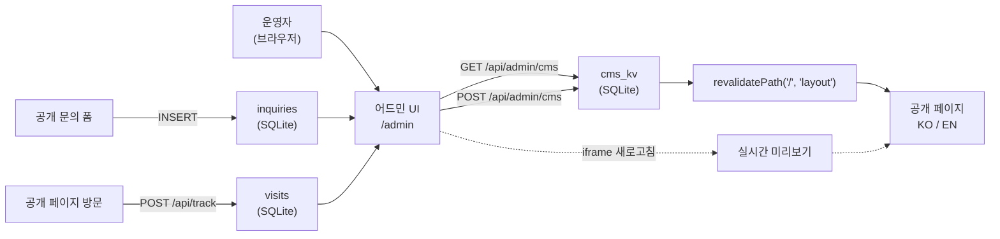
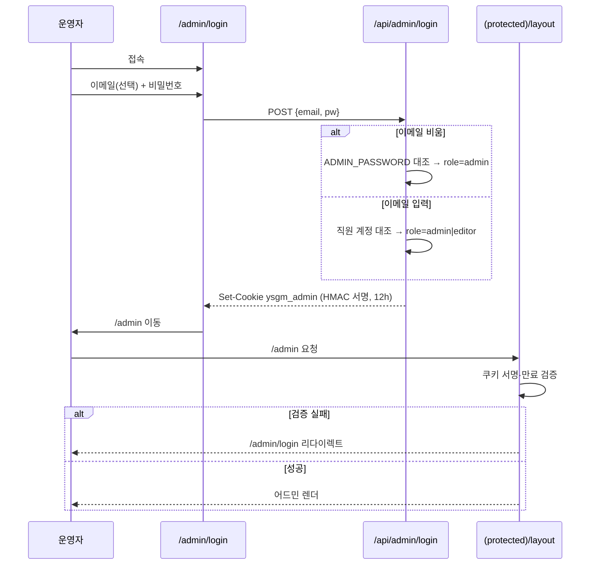
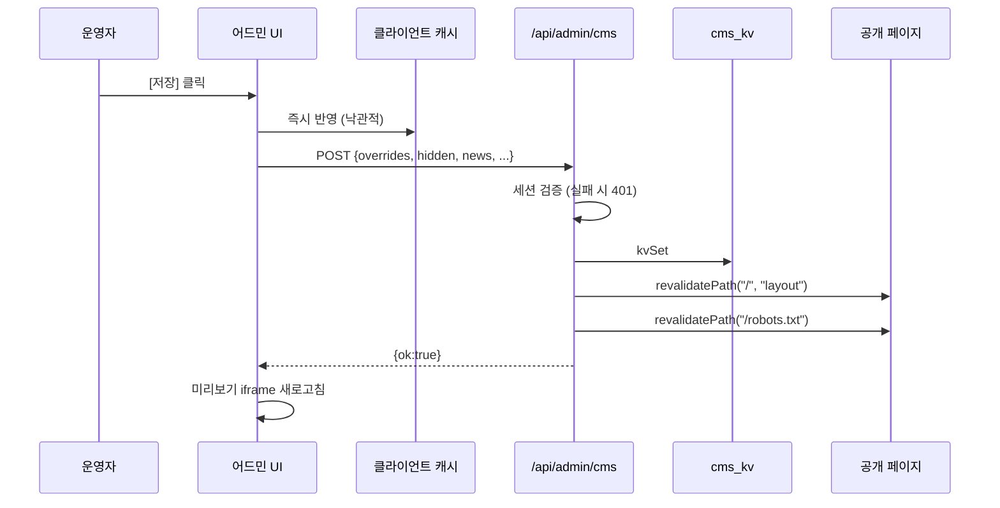
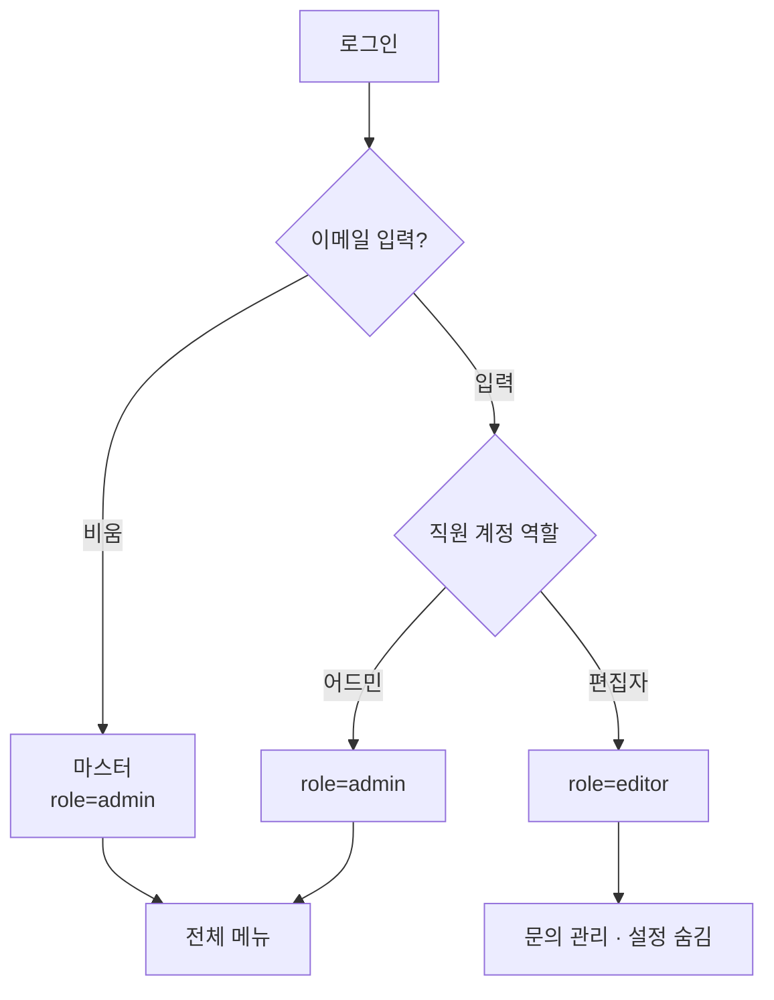

# 여수새고막 어드민 — 시연 플로우

> 목적: **고객사 시연용** 동작 흐름 정리 (운영 매뉴얼은 `여수새고막_어드민_가이드.md` 별도)
> 기준: `main` @ 64dc7dd · 작성 2026-07-16 · 주소 `https://(사이트)/admin`

---

## 0. 시연 한 줄 요약

> **"편집하기 전까지 공개 화면은 1픽셀도 바뀌지 않습니다. 저장한 항목만 덮어쓰고, 언제든 원래대로 되돌립니다."**

이 원칙(**override-on-default**)이 이 어드민의 설계 핵심이자 시연의 메인 메시지입니다.
코드가 기본값(시드)을 갖고 있고, 운영자가 저장한 값만 그 위에 얹힙니다. `[기본값으로 초기화]`를 누르면 얹힌 값이 지워지고 코드 기본값으로 즉시 복귀합니다. **운영자가 사이트를 망가뜨릴 수 있는 경로가 구조적으로 없다** — 이것이 고객사가 들어야 할 문장입니다.

---

## 1. 시스템 구조 한눈에

**핵심 3가지**

| 개념 | 내용 |
|---|---|
| **단일 저장소** | 모든 편집값은 SQLite `cms_kv` 테이블 하나에. 별도 CMS 서버·외부 SaaS 없음 |
| **즉시 반영** | 저장 시 `revalidatePath("/", "layout")` 호출 → 공개 페이지 전체(로케일 포함) 재검증. **배포 없이 즉시 반영** |
| **양방향** | 어드민 → 공개(콘텐츠) / 공개 → 어드민(문의·방문 통계) |

---

## 2. 로그인 플로우

**시연 시 알아둘 것**

- **관리자 로그인은 이메일을 비워둡니다.** 이메일을 채우면 직원 계정 검증으로 빠져 실패합니다 (로그인 화면에도 안내 문구 있음).
- 마스터 비밀번호는 서버 `ADMIN_PASSWORD` 환경변수. 미설정 시 기본값 `yeosu2026!`.
- 개발 환경(`npm run dev`)에서만 **`🔧 관리자 테스트 로그인`** 버튼이 보입니다. 프로덕션 빌드에서는 이 분기가 dead-code로 제거되어 번들에 비밀번호가 포함되지 않습니다 — 보안 질문이 나오면 이 점을 설명하면 됩니다.
- 세션 12시간. 쿠키는 `httpOnly`(JS 접근 불가) + HMAC 서명(위조·권한 승격 불가) + 만료 검증.
- 브루트포스 방어: IP당 10분 내 실패 10회 초과 시 429 차단.

---

## 3. 메뉴 지도

사이드바는 5개 그룹으로 묶여 있습니다. `🔒`는 **어드민 전용**(편집자에게는 메뉴 자체가 안 보임).

| 그룹 | 메뉴 | 무엇을 하는가 |
|---|---|---|
| — | **대시보드** | 신규 문의·게시 뉴스·브랜드/제품·운영 채널 4개 카드(클릭 시 이동) + 최근 문의 + 작업 이력 |
| 웹사이트 | **콘텐츠 관리** | 18개 페이지의 섹션 내용·이미지·순서·노출 편집 (시연 메인) |
| 웹사이트 | **브랜드·제품** | 브랜드 3종과 제품 라인업 CRUD + IA 확장 규칙 자동 안내 |
| 웹사이트 | **뉴스·공지** | 공지/보도/전시회 글 발행·수정·노출·삭제 |
| 웹사이트 | **미디어** | 이미지·영상 라이브러리 (드래그 업로드, URL 복사) |
| 웹사이트 | **헤더·푸터** | GNB 2단계 메뉴트리, 로고, 색상, 사무소·소셜·하단 링크 |
| 웹사이트 | **카테고리 관리** | 제품 허브 탭 순서·노출·라벨 (좌우 드래그) |
| 고객 | **문의 관리** 🔒 | 문의 상태·담당자·상담메모, 검색·필터, CSV 내보내기 |
| 마케팅 | **마케팅 채널** | 판매몰·SNS·광고·오프라인 채널 + UTM 소스 |
| 마케팅 | **검색 노출** | SEO 메타(KO/EN), AI 크롤러 허용/차단, llms.txt 상태 |
| 마케팅 | **통계** | 자체통계(문의) / GA4 / 방문·유입 3탭 |
| 시스템 | **언어팩(i18n)** | 공통 문구 KO/EN 병렬 편집 |
| 시스템 | **설정** 🔒 | 계정·권한 / API 연동 / 활동 로그 |

---

## 4. 핵심 시연 시나리오 (약 15분)

임팩트 순으로 배치했습니다. 시간이 부족하면 **1 → 2 → 5 → 7**만 해도 메시지는 전달됩니다.

### ① 콘텐츠 수정 → 즉시 반영 → 되돌리기 (5분) ★가장 중요

이 시나리오 하나가 어드민 전체를 설명합니다.

1. **콘텐츠 관리** 클릭 → 페이지 탭이 공개 GNB 구조(메인·회사소개·브랜드·제품·수출정보·문의·전역)로 그룹화되어 있음을 보여줌
2. **메인** 선택 → 왼쪽에 **실시간 미리보기**(실제 공개 페이지를 iframe으로 축소 렌더), 오른쪽에 섹션 목록
3. `히어로 슬라이드` 행의 **[편집]** → 오른쪽 드로어에서 슬라이드 문구 수정 → **[저장]**
4. **왼쪽 미리보기가 즉시 갱신됨** → 미리보기 우상단 **[새 탭 ↗]**으로 실제 공개 화면 확인 (배포 없이 반영됨을 증명)
5. 같은 블록을 다시 열면 **[기본값으로 초기화]** 버튼이 생김 → 클릭 → **원래 문구로 복귀**

> **멘트**: "수정한 항목에만 `수정됨` 배지가 붙습니다. 손대지 않은 나머지는 코드 기본값 그대로입니다. 되돌리기는 저장값을 지우는 것이라, 실수해도 원본이 훼손되지 않습니다."

### ② 섹션 순서 드래그 (2분)

1. 섹션 앞 **`⠿` 핸들**을 끌어 순서 변경 (예: `브랜드 필름`을 `ESG·가치` 위로)
2. **드롭하는 순간 자동 저장** — 별도 저장 버튼 없음. `순서 저장 중…` 칩이 잠깐 뜨고 미리보기가 갱신됨
3. **[기본 순서로]**로 복귀

> **주의**: `히어로 슬라이드`는 `고정` 배지 + 회색 핸들 — 최상단 고정이라 이동 불가. "구조는 코드가 통제하고, 운영자는 내용과 순서만 만진다"는 설계 의도를 설명할 지점입니다.
> **주의**: 순서·추가 섹션의 **공개 반영은 현재 메인 페이지만** 지원합니다 (화면 하단에 안내 문구 있음).

### ③ 이미지 교체 → 미디어 자동 수집 (2분)

1. 아무 섹션 [편집] → 이미지 필드에 **파일을 끌어다 놓기**
2. 업로드 즉시 필드에 `/uploads/…` 경로가 채워지고 썸네일 표시
3. **미디어** 메뉴로 이동 → 방금 올린 파일이 라이브러리에 **자동으로 모여 있음**

> 최대 20MB · JPG·PNG·WebP·영상. **SVG는 보안상 차단**(same-origin XSS 방지) — 질문 나오면 설명 포인트.

### ④ 뉴스 발행 (2분)

1. **뉴스·공지** → **[+ 새 글]** → 분류(공지/보도/전시회)·제목·게시일·내용·대표 이미지·연결 링크
2. **[등록]** → 공개 뉴스 목록 상단에 즉시 게시
3. 목록의 토글로 게시/숨김 전환

### ⑤ 헤더·푸터 GNB 편집 (3분) ★두 번째로 임팩트 큼

1. **헤더·푸터** → 왼쪽 **라이브 미리보기**가 타이핑에 맞춰 실시간 갱신됨(저장 전에도)
2. **[+ 상위 메뉴 추가]** → 라벨(국문/영문)·링크·열기(본문/새 창)·노출 입력
3. `⠿` 핸들로 순서 변경, **[+ 하위 메뉴 추가]**로 2단계 구성
4. 상단에 **`저장되지 않은 변경`** 칩 + **[되돌리기]** / **[저장]**
5. **[저장]** → 공개 사이트 GNB에 반영

> 콘텐츠 관리와 달리 여기는 **명시적 저장** 방식입니다(변경 없으면 저장 버튼 비활성). 차이를 물어보면 "메뉴 구조는 실수 영향이 커서 확인 후 저장"으로 설명.

### ⑥ 카테고리 좌우 드래그 (1분)

1. **카테고리 관리** → 좌측 `노출 (탭 순서)` / 우측 `숨김` 2컬럼
2. 카드를 **오른쪽으로 끌면 숨김**, **왼쪽으로 끌면 노출** — 토글 버튼 없이 드래그가 곧 노출 제어
3. 라벨(국문/영문) 인라인 수정 → **[저장]**

### ⑦ 문의 처리 → CSV (2분)

1. **문의 관리** → 상태 탭(전체/신규/상담중/완료/스팸) + 건수, 이름·회사·내용 검색, 유형 필터
2. 문의 클릭 → 드로어에서 **처리 상태 · 담당자 · 상담 메모(내부용)** 입력 → **[저장]**
3. **[CSV 내보내기]** → 현재 필터된 목록이 엑셀용 파일로 다운로드

> **공개 문의 폼 제출이 곧바로 여기 쌓입니다** — 실제 DB 연동 데모 포인트.

### ⑧ 통계 (2분)

1. **통계** → **자체통계** 탭: 기간 프리셋(오늘/이번 주/이번 달) 또는 기간 직접 지정
2. KPI 4장 + 상태별 도넛 + 일별 추이 + 유형별 + 최근 문의 — **실제 문의 DB 기반**
3. **방문·유입** 탭: 총 방문·일평균·유입경로·상위 페이지 — 자체 트래킹(`/api/track`) 기반

> **GA4 탭은 시연에서 열지 마세요.** 아래 §7 참고.

---

## 5. 저장·반영 메커니즘 (기술 질문 대비)

**설명 포인트**

- **낙관적 업데이트**: 저장 누르면 화면이 먼저 바뀌고, 서버 저장은 뒤따릅니다. 체감 지연 0.
- **실패 시**: 네트워크·서버 오류면 `"저장에 실패했습니다. 네트워크 상태를 확인한 뒤 다시 시도해 주세요."` 알림이 뜨고, 미리보기가 서버 실제 상태로 되돌아가 낙관적 변경이 시각적으로 취소됩니다. **조용히 삼키지 않습니다.**
- **override-on-default 저장 구조**: `overrides[블록id] = {값}` 형태. 초기화 = 그 키를 `delete`. 즉 **되돌리기가 데이터 복원이 아니라 삭제**라서 원본 훼손 위험이 없습니다.
- **노출/숨김**은 `hidden[블록id]` 별도 맵. 내용은 그대로 두고 노출만 끕니다.
- **문의 상태 변경은 재검증을 건너뜁니다** — 공개 렌더에 쓰이지 않는 데이터라 불필요한 전체 재검증을 피하는 최적화.

---

## 6. 권한 체계

| 역할 | 가능 | 불가 |
|---|---|---|
| **어드민** | 전 메뉴 + 직원 계정 관리 + 문의 열람/처리 | — |
| **편집자** | 콘텐츠·브랜드·뉴스·미디어·헤더푸터·카테고리·채널·SEO·언어팩 | **문의 관리**(고객 개인정보), **설정**(계정 관리) |

- 역할은 **쿠키 토큰에 서명되어** 있어 클라이언트에서 위조·승격이 불가능합니다.
- 서버에서도 이중 차단: 편집자에게는 `/api/admin/cms` 응답에서 문의 데이터를 **제거**하고, 문의 수정 요청은 403으로 거부합니다. 메뉴만 숨기는 방식이 아닙니다.

---

## 7. 시연 시 반드시 피해야 할 것 ⚠️

고객사 앞에서 "연동됨"으로 소개하면 안 되는 항목입니다.

| 항목 | 실제 상태 | 시연 대응 |
|---|---|---|
| **통계 → GA4 탭** | 화면에 **`리포트 준비중`** 칩이 붙어 있음. 측정 ID·API Secret·속성 ID를 **저장만** 하고, GA4를 호출하는 코드는 없음 | **탭을 열지 않기.** 물어보면 "연동 정보 입력란까지 준비됐고 리포트는 다음 단계"로 정직하게 |
| **설정 → API 연동** | 카카오·네이버·OpenAI·SOLAPI 등 키 저장란. 저장은 되지만 **그 키를 읽어 기능을 켜는 코드가 현재 없음** (화면 문구는 "자동으로 활성화됩니다"라고 표시됨) | 열지 않기. 로드맵 항목으로만 언급 |
| **서브페이지 순서·섹션 추가** | 공개 반영은 **메인 페이지만** 지원 | 순서 드래그 시연은 **메인 탭에서만** |
| **`공개 연동 예정` 배지** | 현재 거의 뜨지 않음(홈 외 페이지의 추가 섹션에만) | 굳이 설명하지 않기 |

**그 외 시연 전 체크**

- [ ] 프로덕션에서 `ADMIN_PASSWORD` 환경변수가 기본값이 아닌지 확인
- [ ] 문의 데이터가 비어 있으면 통계 화면이 밋밋함 → 샘플 문의 몇 건 확보
- [ ] 방문·유입 통계는 트래킹 누적이 필요 → 사전에 공개 페이지 몇 번 둘러보기
- [ ] 미리보기 iframe이 뜨는지(로컬은 `npm run dev` 후 `localhost:3000/admin`)
- [ ] 되돌리기 시연 후 실제로 원복됐는지 공개 화면에서 확인

---

## 8. 예상 질문 & 답변

**Q. 수정하면 배포해야 하나요?**
아니요. 저장 즉시 `revalidatePath`가 공개 페이지를 재검증해 바로 반영됩니다.

**Q. 잘못 건드리면 사이트가 망가지나요?**
구조적으로 어렵습니다. 섹션 구조·레이아웃·디자인은 코드가 통제하고(이동 불가 섹션은 `고정` 배지), 운영자는 내용·순서·노출만 만집니다. 모든 편집은 `[기본값으로 초기화]`로 되돌아갑니다.

**Q. 직원이 고객 문의를 볼 수 있나요?**
편집자 역할은 메뉴가 숨겨질 뿐 아니라 서버 응답에서도 문의 데이터가 제거됩니다.

**Q. 영문 사이트는요?**
공통 문구(메뉴·푸터 등)는 **언어팩(i18n)**에서 KO/EN 나란히 편집합니다. 원본과 다른 값만 저장되고 같아지면 자동으로 원본을 따릅니다. 본문 콘텐츠·뉴스는 현재 한국어 기준입니다.

**Q. 이미지는 어디에 저장되나요?**
서버 `/uploads`에 저장되고 미디어 라이브러리에 자동 등록됩니다. 외부 CDN·S3 의존 없음.

**Q. 로그인 세션은?**
12시간. `httpOnly` + HMAC 서명 쿠키라 탈취·위조가 어렵고, 로그인 실패 10회면 10분 차단됩니다.

---

## 부록. 관련 문서

- `여수새고막_어드민_가이드.md` — 운영 매뉴얼(비개발자용). 시연 후 고객사에 전달하는 문서. 2026-07-16 기준 최신화 완료
- `여수새고막_IA.md` — 정보구조 v2.0 (브랜드·제품 확장 규칙의 근거)
- `여수새고막_기능정의서.md` · `여수새고막_기획서_PRD.md`
- `qr-tracking.md` · `db-backup-restore.md`
